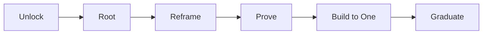

# Root-to-One CEO Brief

**Find the root. Reframe the system. Prove the next move before you build the whole thing.**

Root-to-One CEO Brief turns a hard strategic or zero-to-one problem into a compact executive case study.

It is designed for situations where the visible question may be at the wrong layer: a feature request that is really a system problem, an apparent A-or-B choice that hides a third path, or a proposed build that has not yet earned the right to exist.

## The operating sequence



The CEO-facing rendering is intentionally more natural:

**Opportunity → Problem → Reframe → Mental Model → North Star → Visual → How We Learn → Real Example → Experiment → Decision → Build to One → Graduate → Restatement**

The framework stays underneath the memo. The reader gets the decision.

## What makes the brief different

### Start with the business outcome

Do not begin with architecture, AI, or the requested feature.

State what the business is trying to unlock and what cannot be compromised.

### Reframe the system

The central question is often not “what should we build?” but “are we solving the real problem at the right layer?”

A strong reframe changes the decision itself.

### Require a visual

Every completed brief includes at least one visual that explains the reframe faster than prose: a heatmap, portfolio matrix, system map, frontier, before/after, or another simple decision model.

### Require a real example

Every completed brief includes at least one documented real-world example and explicitly separates:

- what happened;
- what it teaches; and
- what it does **not** prove about the case at hand.

### Prove before architecture

Define the cheapest decisive test before prescribing the full system.

A prototype is not one. A promising test is not one.

The build phase starts after the core mechanism has earned it.

## Real example: eBay paid-search experiments

A useful example of the difference between attribution and incrementality comes from large-scale field experiments conducted at eBay.

Researchers shut off non-brand paid-search advertising for a random sample representing about 30% of eBay's U.S. traffic for 60 days. The aggregate effect of non-brand search advertising was small, while the results varied materially by customer type: new and infrequent users were more positively influenced than frequent users. Separate brand-keyword experiments found no measurable short-term benefit from brand search ads.

Source: Thomas Blake, Chris Nosko, and Steven Tadelis, *Consumer Heterogeneity and Paid Search Effectiveness: A Large Scale Field Experiment*, NBER Working Paper 20171 / Econometrica (2015): https://www.nber.org/papers/w20171

**What it teaches:** an average campaign result can hide very different incremental value across segments, and observational attribution can overstate causal value.

**What it does not prove:** that another company's marketing economics, channels, customers, or optimal spend reductions will behave the same way.

That distinction is part of the skill, not a footnote.

## Example prompt

```text
Use Root-to-One CEO Brief on this problem.

We have a large portfolio of products and markets. Leadership believes some mature areas may no longer need the same level of paid demand generation, but new launches and expansion markets may need more. We want to reduce total marketing spend over time without slowing the growth plan.

Create the CEO brief. Include one visual, one documented real example, the cheapest decisive experiment, and the decision the evidence should unlock.
```

## Output standard

The brief uses these headings:

- Opportunity
- Problem
- Reframe
- Mental Model
- North Star
- Visual
- How We Learn
- Real Example
- AI-Native, when material
- Experiment
- Decision
- Build to One
- Graduate
- Restatement

The writing style is executive memo, not social post: compact prose, clear headings, minimal slogans, no architecture dump, and no fake precision.

## Install

There is one shared implementation:

[`SKILL.md`](./SKILL.md)

For Agent Skills-compatible environments:

```bash
npx skills add yoda-sahb/Gen_AI_Skills_Personal --skill root-to-one-ceo-brief
```

## Public-method boundary

This skill is a public, executable rendering of the Root-to-One method for CEO-level case studies. It does not include private CareerOS controls, confidential company evidence, unreleased implementation details, or proprietary source material from other methods.

External examples are evidence about mechanisms, not proof that a target company has the same economics or outcome.
