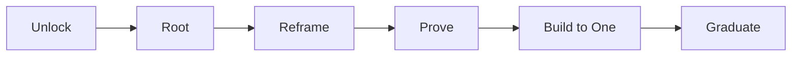

# Samurai 3.0

**Find the real problem. Prove the next move.**

Samurai is a conversational Agent Skill for anyone facing a difficult problem. Start with what is happening, not a proposed platform, feature or organizational solution. The method adapts to the problem and asks only the next necessary question.

**Status: public preview.** This version is designed for cross-role evaluation and pilots, not yet independently validated for enterprise-wide deployment.

## The operating sequence



The six moves are the user-facing journey. Underneath them, the inventor-architect method remains:

`Breadth → Abstraction → Analogy → Synthesis → Architecture → Invention → Execution`

The goal is to produce a better decision with evidence, not a longer framework report.

## What makes Samurai different

### Find the root before choosing a solution

Separate the symptom from the mechanism causing it. Look across functions, distinguish existing evidence from inference, and ask whether the relevant constraint is fundamental or inherited from the current system.

### Compare real alternatives

Use buyer-relative value to compare the proposal with the best existing workaround, another product, a simpler internal fix, delay, or doing nothing. A technically impressive invention is not automatically the most valuable choice.

### Prove before scaling

Use the smallest honest test. A conceptual rendering, synthetic demonstration, working prototype, controlled experiment, production launch and sustained adoption are separate evidence states. Record what each proves and does not prove.

### Anticipate failure and design adoption

For consequential choices, run a pre-mortem with warning signs and stop conditions. Address decision rights, incentives and operational friction. A worthwhile idea that people cannot or will not use is not yet a durable capability.

## Use it for

- Customer complaints and recurring service failures
- Product, engineering and operational problems
- Strategy, prioritization and resource allocation
- Competing objectives that appear impossible to reconcile
- Innovation and system-architecture decisions
- Testing a concept before substantial investment
- Planning adoption, ownership and scale

A local, reversible issue may require a quick fix rather than all seven stages. The correct result can also be **reuse an existing solution, request more evidence, escalate, or stop**.

## Example prompt

```text
Use Samurai 3.0. I have a problem:

[Describe what is happening.]

Help me find the root cause, compare the best existing alternatives,
design the smallest honest test, and anticipate how the plan could fail.
Ask one question at a time only when needed.
```

## Proof and evaluation

This release includes [18 cross-role evaluation scenarios](./evals/cases.json), a [structural evaluation runner](./evals/run_evals.py), and a [human-review protocol](./references/EVAL_PROTOCOL_3.md). Its original invention, novel-transfer, and patent-discovery references remain available.

**Structural checks are not proof of reasoning quality, safety, or business outcomes.** Independent evaluations, adverse-case reviews and actual usability studies remain necessary.

## Install

There is one shared implementation:

[`SKILL.md`](./SKILL.md)

For Agent Skills-compatible environments:

```bash
npx skills add yoda-sahb/Gen_AI_Skills_Personal --skill samurai-3
```

No separate ChatGPT or Claude implementation is required. Users should not provide confidential or personal data to an environment that has not been approved to receive it.

<details>
<summary><strong>Earlier Samurai versions</strong></summary>

- [Samurai v2.2](../samurai/README.md) is the last stable inventor-architect baseline.
- [Samurai v2.5-beta](../samurai-beta/README.md) is an experimental archive. Its additional gates are not independently validated.

Both remain available for comparisons and historical provenance.

</details>

## Attribution and boundaries

Samurai 3.0 integrates distinct public methods rather than claiming one author created all of them. The separate [Root-to-One CEO Brief](../root-to-one-ceo-brief/README.md) supplies the six-move problem-to-proof sequence. [Product Value-Strategy](../product-value-strategy/README.md) draws on concepts attributed to Dwight Porter with separate operational extensions. Adoption guidance draws on high-level principles from *Switch* by Chip and Dan Heath.

New routing, pre-mortem and evaluation procedures are part of the Samurai 3.0 integration. All company examples used for training are hypothetical unless independently documented. The skill provides reasoning support, not legal authorization, patent rights, production verification or permission to handle restricted data.
